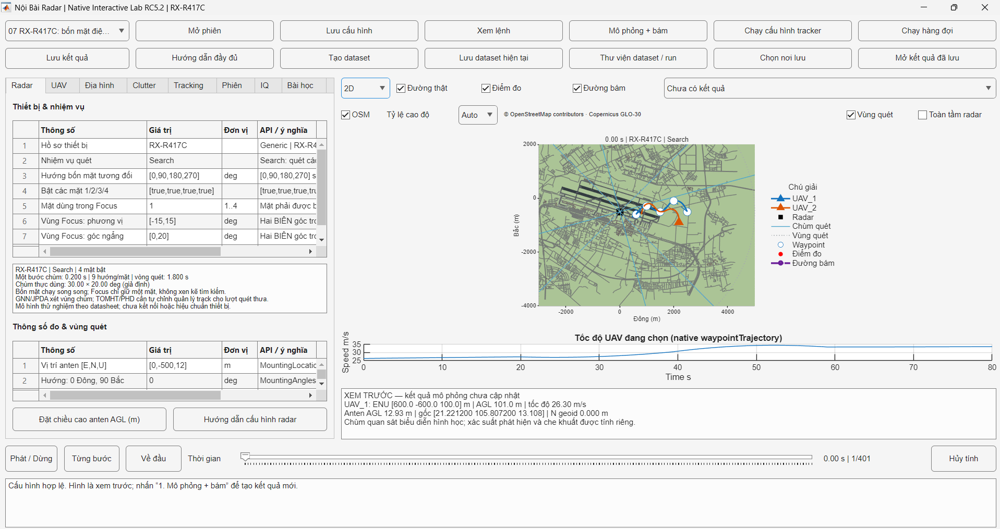
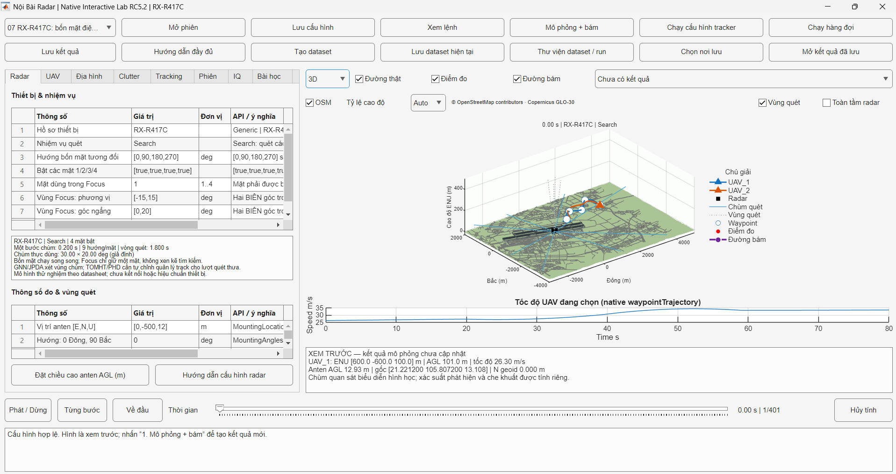

<div align="center">

# Radar & UAV Simulation Lab

**Cấu hình · Mô phỏng · Bám mục tiêu · Phân tích dữ liệu**

Ứng dụng MATLAB để xây dựng kịch bản radar–UAV, quan sát trên bản đồ 2D/3D và so sánh các cấu hình bám mục tiêu.


[Bắt đầu](#bắt-đầu) · [Tính năng](#tính-năng) · [Giao diện](#giao-diện) · [Cấu trúc project](#cấu-trúc-project)

</div>

## Bắt đầu

**Yêu cầu:** MATLAB R2025a cùng Radar Toolbox, UAV Toolbox, Mapping Toolbox và Sensor Fusion and Tracking Toolbox. Bài thực hành IQ cần thêm Phased Array System Toolbox; cài các sản phẩm phụ thuộc theo yêu cầu của MATLAB.

1. Tải và giải nén toàn bộ project, giữ nguyên cấu trúc thư mục.
2. Trong MATLAB, đặt **Current Folder** vào thư mục chứa `START_NATIVE_LAB.m`.
3. Chạy:

   ```matlab
   START_NATIVE_LAB
   ```

4. Nhấn **Hướng dẫn đầy đủ** ở hàng nút thứ hai, nút thứ hai từ trái sang, để mở sổ tay: giải thích thuật ngữ, đơn vị, tham số và **32 bài thực hành từng bước**.

> Dữ liệu mặc định đi kèm project; không cần sửa đường dẫn trong mã. Sổ tay HTML mở trong trình duyệt từ ứng dụng, không cần kết nối Internet.

## Tính năng

| Nhóm | Chức năng |
| :--- | :--- |
| **Radar** | Cấu hình vị trí, hướng, vùng quét, cự ly và nhiễu; hồ sơ Generic hoặc mô hình RX-R417C bốn mặt quét điện tử với Search/Focus. |
| **UAV** | Thêm mục tiêu, chỉnh RCS, waypoint và thời điểm đến; kéo waypoint trên bản đồ 2D, xem quỹ đạo trong 3D. |
| **Địa hình & clutter** | Đọc DEM, hiển thị OSM, chuyển tọa độ LLA/ENU, kiểm tra đường nhìn; cấu hình báo động giả và các điểm phản xạ tĩnh. |
| **Tracking** | Chọn GNN, JPDA, TOMHT hoặc PHD; chọn bộ ước lượng tương thích, chỉnh tham số quản lý track và chạy hàng đợi cấu hình trên cùng dataset. |
| **Dataset & kết quả** | Lưu cấu hình, tạo dataset mới, lưu kết quả bám, mở lại thí nghiệm và chọn thư mục lưu trữ. |
| **Quan sát & đánh giá** | Chuyển 2D/3D, phát lại theo thời gian, bật/tắt các lớp hiển thị và xem chỉ số đánh giá. |
| **Bài IQ riêng** | Thực hành LFM, clutter, matched filter, CFAR và mảng anten ULA bằng các API MATLAB. |

**Luồng thao tác:** Chọn kịch bản → chỉnh cấu hình → **Mô phỏng + bám** → xem/phát lại → **Lưu dataset hiện tại** hoặc **Lưu kết quả**.

Mô hình RX-R417C phục vụ thử nghiệm mô phỏng, chưa kết nối thiết bị thật; Focus chưa tái hiện chế độ TAS của nhà sản xuất. Bài IQ chạy độc lập, chưa cấp phép đo cho luồng tracking.

## Giao diện

### Cấu hình radar và bản đồ 2D

Cấu hình thiết bị và nhiệm vụ quét trong tab **Radar** bên trái. Bên phải là bản đồ OSM, quỹ đạo UAV và chú giải; biểu đồ phía dưới thể hiện tốc độ UAV đang chọn.



### Không gian 3D

Chọn **3D** trong danh sách phía trên bản đồ để xem cao độ, đường bay và hình học vùng quét. Chú giải nằm riêng bên phải; thanh thời gian phía dưới dùng để phát lại hoặc xem từng bước.



*Ảnh giao diện RC5.2 với hồ sơ RX-R417C, nhiệm vụ Search. Cả hai ảnh ở chế độ xem trước, trước khi chạy mô phỏng và bám mục tiêu.*

## Cấu trúc project

```text
project/
├── START_NATIVE_LAB.m       # Điểm khởi chạy giao diện
├── NATIVE_LAB_CHECK.m       # Kiểm tra sự hiện diện của các API
├── NATIVE_LAB_TESTS.m       # Chạy các bộ kiểm thử
├── native_lab/             # Giao diện, cấu hình và luồng mô phỏng tương tác
│   ├── nl_app.m            # Các tab, nút và xử lý thao tác
│   ├── nl_simulate.m       # Mô phỏng cảnh UAV và thu phép đo radar
│   ├── nl_radar.m          # Tạo mô hình radar bằng API toolbox
│   ├── nl_make_tracker.m   # Khởi tạo bộ bám theo cấu hình
│   ├── nl_track.m          # Chạy bám và tính chỉ số đánh giá
│   ├── docs/              # Sổ tay HTML và tài liệu cấu hình
│   ├── examples/          # Dữ liệu và ví dụ nhập liệu
│   └── tests/             # Kiểm thử nhánh tương tác
├── data/                   # DEM, bản đồ OSM và các dataset đi kèm
├── config/                 # Cấu hình nền của project
├── src/                    # Các hàm xử lý và thuật toán của project gốc
├── training/               # Nhánh bài thực hành toolbox
├── docs/                   # Tài liệu và hình minh họa
├── tests/                  # Kiểm thử của project gốc
├── tools/                  # Công cụ hỗ trợ dữ liệu
└── results/                # Kết quả sinh khi chạy; không có sẵn trong gói
```

Các điểm chạy và dữ liệu của project gốc được giữ lại. Để dùng giao diện được giới thiệu tại đây, bắt đầu bằng **`START_NATIVE_LAB`**.

---

<p align="center"><sub>Bản đồ: © OpenStreetMap contributors · Địa hình: Copernicus GLO-30</sub></p>
